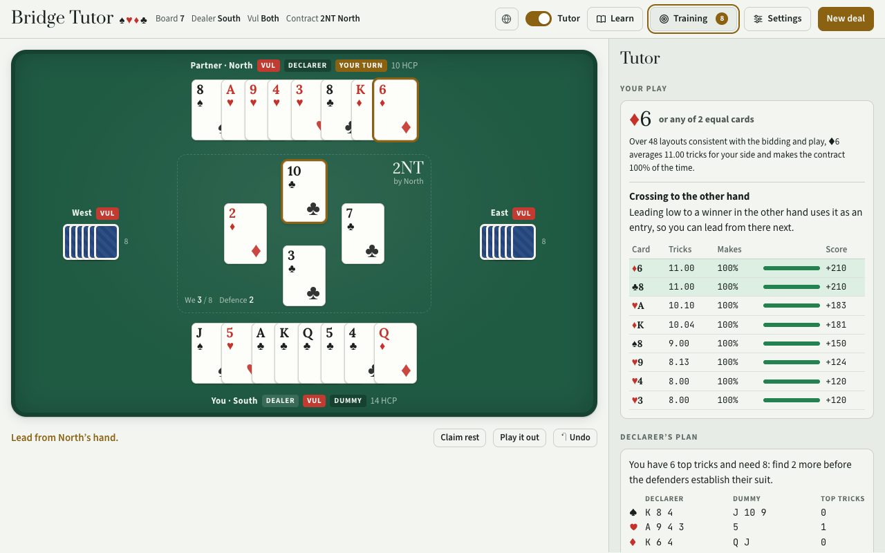
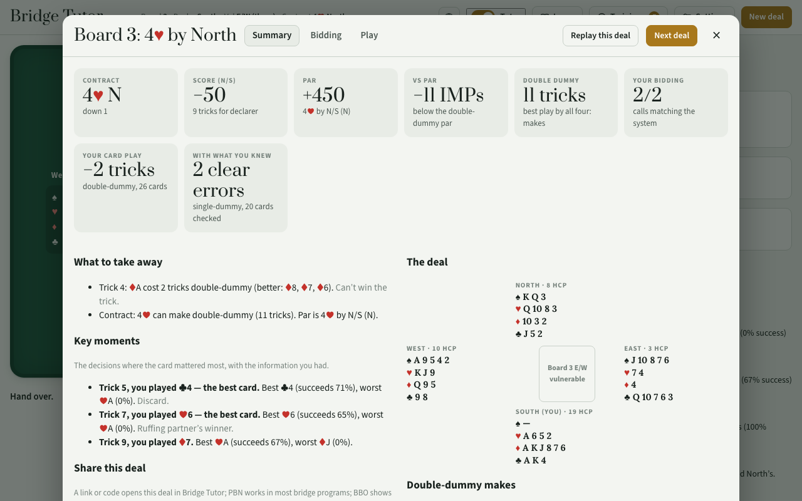
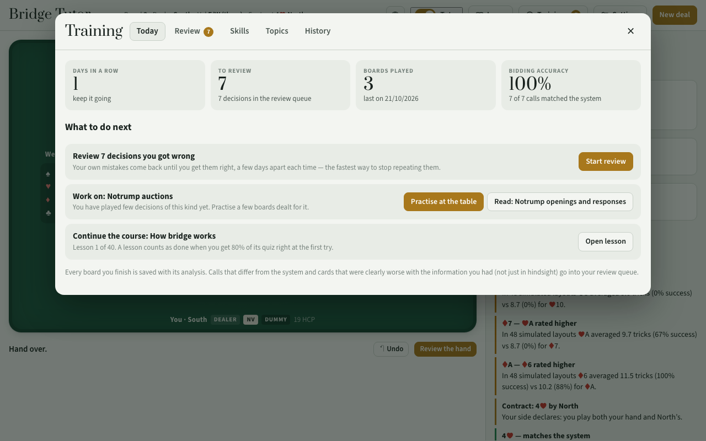
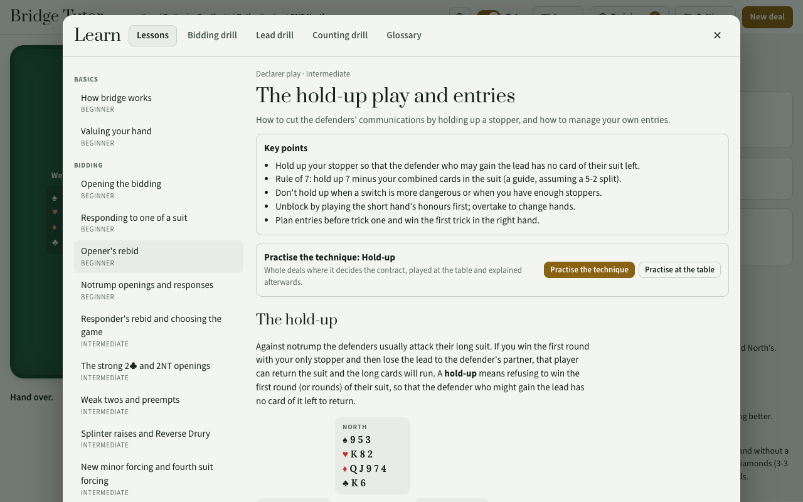

# Bridge Tutor

[](https://github.com/otsirh/bridge-tutor/actions/workflows/ci.yml)
[](LICENSE)

**Play contract bridge against three bots, with a tutor that explains every bid and card — and a
training loop built around your own mistakes.**

**▶ Play: https://bridge-tutor.pages.dev** — works offline and installs as an app.



You sit South; North is your partner. When your side declares, you play both hands.

## How it helps you improve

**At the table, the tutor explains every decision** (switch it on or off at any moment):

- **Bidding**: the recommended call, the rule behind it and a checklist of its requirements against
  your hand ("13+ HCP — you have 14"), plus every other call it considered and why it doesn't fit.
  Hover a bid to see what it would tell partner; click any call in the auction to see what it showed.
- **Card play**: the card that does best across many simulated layouts of the hidden hands that fit
  the bidding and the play so far (each solved double-dummy), with tricks, success rate and score per
  card, and the principle behind it (second hand low, cover an honour, draw trumps, …).
- **Declarer plan** when dummy comes down, **counting** of the hidden hands, and **reading the play**:
  leads and partner's signals.
- **Signals**: the bot defenders give standard attitude, count and suit-preference signals (only with
  cards that cost nothing) and use their partner's; the tutor reads them for you and tells you which
  card to signal with.
- **Think first**: the recommendation stays hidden until you ask, and as declarer you count your
  losers or top tricks before the plan is shown. **Coach**: asks you to confirm a clear mistake.

**After the hand, the review**: your score against double-dummy par in IMPs, the contract the system
would have reached (and how yours compares), a game or slam you missed, every call compared with the
system, every card checked both double-dummy (hindsight) and with the information you had, and the
key moments where the card mattered most — each one can be played again from that point. Replay the
deal, or share it as a link, a code, PBN or a BBO hand.



**The Training room** turns your play into practice:

- **Review**: calls that differed from the system and cards that were clearly worse *with what you
  knew* come back as drills, spaced over days until you get them right; a bidding mistake alternates
  with a fresh deal on the same rule, so you learn the idea rather than the board.
- **Bidding only**: practise auctions without playing the cards; each contract is scored with best
  play and compared with the system's.
- **Skills**: accuracy in nine areas — opening, responding, rebids, notrump, competitive, slam,
  opening leads, declarer play, defence — with the weakest one suggested next.
- **Techniques**: whole deals where one declarer technique decides the contract — a finesse, the
  hold-up, ducking, unblocking, drawing trumps, ruffing in the short hand (and the rare safety play) —
  chosen by simulation with only declarer's information, played at the table and explained afterwards.
- **Topics**: boards dealt so a topic really comes up (Stayman, splinters, negative doubles, balancing,
  3NT hold-ups, opening leads, …): each deal is tested against the system's own auction.
- **History**: every board kept in full, to review or play again. Back up and restore your progress.



**Learn**: 44 lessons from the basics to squeezes and endplays, each with a quiz and practice deals at
the table, a glossary, and drills for bidding, opening leads and declarer counting.



## System

Standard American Yellow Card: 15–17 1NT, 20–21 2NT, five-card majors, better minor, strong 2♣,
weak twos, Stayman, Jacoby transfers (and a minor-suit transfer), Jacoby 2NT, limit raises,
negative doubles, takeout doubles, Michaels, Unusual 2NT, weak jump overcalls, Blackwood, Gerber,
quantitative 4NT. Standard leads and signals (attitude, count, suit preference). Duplicate scoring.

Modern conventions, each switchable in Settings (all on by default except Drury): Roman Key Card
Blackwood 1430 with the queen and king asks, splinter raises, control (cue) bidding for slam, new
minor forcing, fourth suit forcing, Texas transfers and reverse Drury. Every convention has a lesson.

## Development

```sh
npm install
npm run dev          # http://localhost:5173
```

| Command | What it does |
|---|---|
| `npx tsc --noEmit` | type-check |
| `npm run lint` | Biome |
| `npm test` | unit tests: solver against brute force, scoring, bidding and conventions, every language, lessons, journal, deal formats |
| `npm run build` | the website in `dist/`: code-split, each language loaded only when chosen, plus the icons, manifest and service worker |
| `npm run build:single` | one self-contained `dist-single/index.html` with everything inlined, for hosts that take a single page |
| `npm run test:e2e` | plays the built app in a real browser (Playwright); `PW_CHROMIUM=/path/to/chrome` uses an installed browser |

CI runs all of them on every push and pull request. Every push to `main` is deployed to
https://bridge-tutor.pages.dev by Cloudflare (build command `npm run build`, output `dist`, Node
from `.node-version`). See [CONTRIBUTING.md](CONTRIBUTING.md) for the ground rules.

### Layout

| Path | What |
|---|---|
| `src/core` | cards, auction, play, scoring (IMPs and par), hand evaluation, PBN / LIN / share codes |
| `src/bidding` | the rule-based SAYC engine and the optional conventions: each rule's conditions drive the bots, the explanations and the inferences |
| `src/engine` | double-dummy solver (partition search with a transposition table), deal sampler, Monte Carlo card play, defensive signalling, opening leads, worker pool |
| `src/tutor` | declarer planner, play principles, reading the play |
| `src/game` | game controller, settings, the practice journal (archive, review queue, skills) and practice themes |
| `src/ui` | the interface |
| `src/learn` | lessons and glossary, per language |
| `src/i18n` | languages and text catalogues |
| `test`, `e2e` | unit tests and browser tests |

### Languages

All text lives in per-language catalogues; the code never contains user-facing strings.

| Path | What |
|---|---|
| `src/i18n/index.ts` | language list, loading and switching languages (`setLang`, `onLangChange`), formatting helpers |
| `src/i18n/<lang>/` | the catalogue: `core` (cards, seats, calls), `ui`, `bidding`, `tutor`, `practice` |
| `src/learn/content/<lang>/` | lessons and glossary |

English defines the shape of the catalogue; the compiler rejects a language that misses a key or
changes a function's parameters. The bots' behaviour never depends on the language: tests check that
whole auctions, inferences and tutor decisions are identical in every language.

**Adding a language** (e.g. Swedish, `sv`):

1. Copy `src/i18n/en` to `src/i18n/sv` and translate it (keep the keys and function signatures; adapt
   grammar inside the functions — plurals, word order).
2. Add `'sv'` to `Lang` and `LANGUAGES` in `src/i18n/index.ts` (with its locale, and its list, unit and colon
   separators if they differ from English) and to its `LOADERS`.
3. Optionally add lessons in `src/learn/content/sv/` (same ids, diagrams and quiz answers as English;
   `test/lessons.test.ts` checks this) and add it to the `LOADERS` in `src/learn/lessons.ts`. Until
   then the English lessons are shown.
4. `npx tsc --noEmit && npm test`.

## License

MIT — see [LICENSE](LICENSE).
